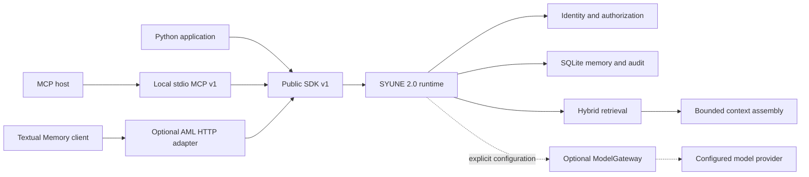

# SYUNE 2.0

> Governed persistent memory for AI applications and agents.

SYUNE is a local-first Python runtime for durable memory, authorized retrieval,
provenance-aware context, and optional governed model execution. Version 2.0 adds
source-event timestamps, crash-safe idempotent batch ingestion, configurable native
recall up to 100 candidates, and a secured Textual Memory Add/Search adapter.

Traditional RAG primarily asks: **What information is relevant?** SYUNE also governs:

- Who may use it, and for what purpose?
- Which version is current, and what was valid at a requested time?
- Where did the information come from?
- Is it still active and retrievable?
- What bounded context actually reached the model?

## How it differs

SYUNE can use retrieval and RAG techniques; it adds governance before information becomes
model-visible.

```text
Traditional RAG                 SYUNE

Query                           Query
  ↓                               ↓
Retrieval                       Identity + Purpose
  ↓                               ↓
Top-K context                   Authorization
  ↓                               ↓
LLM                             Temporal / Version eligibility
                                  ↓
                                Hybrid Retrieval
                                  ↓
                                Lifecycle
                                  ↓
                                Provenance
                                  ↓
                                Bounded Context
                                  ↓
                                ModelGateway
                                  ↓
                                LLM
```

## Architecture



See the [SYUNE v2 architecture](docs/architecture/SYUNE_V2_ARCHITECTURE.md) for component
boundaries, persistence, ingestion, retrieval, security, and experimental surfaces. The
[Lean v1 architecture](docs/architecture/LEAN_V1_ARCHITECTURE.md) remains available as
historical design documentation.

## Connect SYUNE

SYUNE is model- and agent-framework independent. Connect it to Codex, Claude Code,
Claude Desktop, or another stdio MCP host through the canonical Lean MCP server, or
embed it in a custom Python application through the SDK. This is protocol-level
integration, not a claim that every agent framework has a native SYUNE adapter.

Using SYUNE for MCP memory and context does **not** inherently require a separate LLM
API credential. The host continues to reason with its own model access; SYUNE supplies
governed persistent memory and bounded context. ModelGateway is an optional second mode
for applications that explicitly configure provider execution.

Run `syune setup` and then `syune doctor` to prepare persistent state, save the exact
installed MCP tuple, and validate a real handshake. Setup never edits third-party
configuration.

Start with [MCP host integration](docs/integrations/MCP_HOSTS.md), the
[MCP contract](docs/MCP_V1.md), or the [Python SDK](docs/PYTHON_SDK.md).

## Version 2.0 capabilities

### Governed agent memory

An agent retrieves relevant memory without receiving records outside its authorized
identity or scope. Purpose and task context are carried through retrieval and audit.

### Version-aware knowledge

Applications distinguish `CURRENT`, `HISTORICAL`, and `AS_OF` information instead of
treating every stored record as simultaneously current.

### Traceable context

Model-visible context retains provenance and lineage so developers can determine where
the information came from and correlate it with durable audit events.

### Reliable model execution

ModelGateway centralizes structured output, retry, repair, fallback, budgets, provider
policy, health, evidence, and audit without coupling the memory layer to one provider.

### Durable batch ingestion

`Syune.add_batch()` atomically stores ordered messages and their idempotency record in
one SQLite transaction. Identical retries return the original logical result; reuse of
an identifier with different content fails without creating duplicate memories.

### Source-event timestamps

`RememberRequest.observed_at` and batch-message timestamps preserve source/event time
independently from ingestion, provenance-recording, and fact-validity time. Inputs must
be timezone-aware and are normalized to UTC.

### Configurable native recall

The product default remains 16 results. Deployments may configure up to 100 native
recall candidates; working-memory capacity remains 8. Retrieval continues to apply
authorization, lifecycle, temporal eligibility, native scoring, and deterministic rank
ordering.

## Quick start

Requires Python 3.12 or newer (below 4).

```console
git clone https://github.com/Npalyan002/Syune-AI.git
cd Syune-AI
git checkout v2.0.0
python -m venv .venv
python -m pip install --upgrade pip
python -m pip install .
python -m syune.quickstart --state-root ./.syune-demo
```

Use the Python executable inside the virtual environment where your platform does not
activate it automatically. These source-install instructions do not assert that version
2.0.0 is available from PyPI.

```python
from pathlib import Path
from syune import ContextRequest, ProvenanceMode, Syune

with Syune.open(state_root=Path(".syune-demo").resolve()) as memory:
    stored = memory.remember("The deployment window is Friday at 18:00 UTC.")
    context = memory.context(ContextRequest(
        "deployment window",
        purpose="release-planning",
        provenance_mode=ProvenanceMode.FULL,
    ))

    print(stored.data["memory_id"])
    print(context.data["rendered"])
    print(context.data["items"][0]["provenance"])
```

The [full quickstart](docs/QUICKSTART.md) covers revision, `CURRENT`, historical/`AS_OF`
queries, lifecycle, durable audit, shutdown, and restart. More focused programs are in
[`examples/`](examples/README.md).

Stable file Study supports individual TXT, Markdown, and text-based PDF sources through
the Python SDK. It does not recursively ingest folders or repositories. See the
[ingestion capability matrix](docs/INGESTION.md).

## Interfaces

- [Python SDK](docs/PYTHON_SDK.md): synchronous local lifecycle, memory, batch ingestion,
  recall, context, revision, lifecycle, audit, Study, and optional ModelGateway.
- [MCP v1](docs/MCP_V1.md): eight-tool local stdio interface for MCP hosts.
- [Textual Memory HTTP adapter](docs/AML_HTTP_ADAPTER.md): authenticated `/add` and
  `/search`, public `/health`, global request-ID conflict protection, and up to 100 raw
  native candidates. It is an integration adapter, not the only supported use of SYUNE.

## Security and governance

Stored records retain typed identity, provenance, timestamps, lifecycle state, and an
optional owner envelope. Retrieval evaluates authorization before returning candidates.
The AML deployment uses evaluation-only state, constant-time Bearer authentication,
bounded concurrency, size limits, sanitized errors, payload-free logs, non-root
containers, and a private readiness endpoint. See the [security policy](SECURITY.md) and
[threat model](docs/threat_model.md).

## Validation evidence

One frozen synthetic validation compared Strong RAG with Lean SYUNE on authorized useful
recall and context cleanliness:

| Metric | Strong RAG | Lean SYUNE |
|---|---:|---:|
| Authorized useful recall | 100% | 100% |
| Precision | 45.5% | 100% |
| Context precision | 45.5% | 100% |

SYUNE excluded 60 unauthorized records, one superseded record, one future-invalid record,
and six lifecycle-ineligible records. This is one controlled validation, not a universal
benchmark claim. SYUNE did **not** improve authorized useful recall over Strong RAG in
this dataset; it improved the cleanliness and governance of the resulting context.

That historical synthetic result is not an independent benchmark, an AML result, or a
general performance claim. Read the [Lean v1 validation](docs/benchmarks/LEAN_V1_VALIDATION.md)
for its methodology and limitations. The v2.0.0 release candidate passed 469 repository
tests locally in the Phase 06B workspace; environment-specific historical test records
remain in the release and validation documentation.

The AML Add/Search adapter does not call a generative LLM. Native hybrid retrieval does,
however, use a local 64-dimensional deterministic token-feature hashing provider and a
linear vector index. Whether that deterministic vectorization is treated as an embedding
model under the current AML Open-source Methods policy remains under organizer review.
SYUNE has not completed an official AML evaluation and has no official AML score or rank.

## Documentation

Start with the [documentation index](docs/README.md), [public API](docs/PUBLIC_API_V1.md),
[Python SDK](docs/PYTHON_SDK.md), [MCP interface](docs/MCP_V1.md),
[configuration](docs/CONFIGURATION.md), and [security policy](SECURITY.md).

## Stable and experimental boundaries

Public API v1 and MCP v1 remain the stable protocol contracts shipped by SYUNE 2.0. The
package major version does not rename those protocols. Research cognition, learning,
Council, Planner, and Executive code is experimental or compatibility-only and disabled
by default. SYUNE is not an autonomous truth engine, answer generator, or organizational
learning system.

## Major limitations

- Deployment is single-node SQLite.
- The default vector backend is local-linear, not a production ANN service.
- High-contention multi-process writes are unsupported.
- Research cognition and learning are disabled by default.

See [known limitations](docs/known_limitations.md) for the complete list.

SYUNE 2.0.0 exposes Public API v1 and MCP v1 and is licensed under the
[Apache License 2.0](LICENSE).
