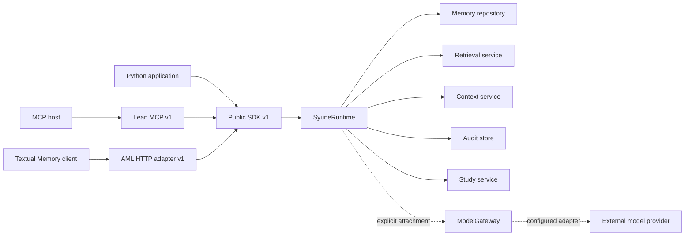
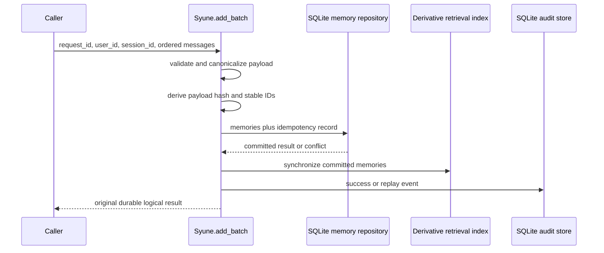
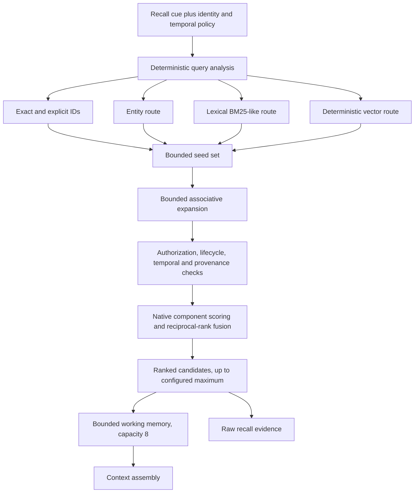

# SYUNE v2.0 architecture

This document describes the implemented SYUNE 2.0.0 product at immutable commit
`23d76717feff156849acc5e6b66aac088cd92afb`. Public API v1 and MCP v1 are protocol
versions; they remain the stable interfaces shipped by package version 2.0.0.

## Product boundary

SYUNE is a local, synchronous governed-memory runtime. Applications may call the Python
SDK directly, expose the canonical stdio MCP interface to a host, or opt into the Textual
Memory HTTP adapter. The HTTP adapter is one integration boundary, not the product's only
use case.

The memory, retrieval, context, and audit path requires no generative model credential.
ModelGateway is optional and is invoked only through an explicitly attached gateway.

## Stable components

### Public Python SDK

`Syune` owns one lifecycle-managed runtime. Its stable product surface includes state
open/close, health, capability discovery, remember, atomic batch add, memory lookup,
recall, context, revision/history, lifecycle operations, audit, Study, and optional model
execution. The SDK returns public result types rather than repositories or connections.

### MCP v1

The canonical local stdio server exposes eight tools: health, remember, context, revise,
forget, history, audit, and model. The MCP host performs its own reasoning. Study and
research orchestration are not exposed by the canonical MCP server.

### Textual Memory HTTP adapter

The optional FastAPI adapter exposes unauthenticated `GET /health` and Bearer-protected
`POST /add` and `POST /search`. It maps Add to `Syune.add_batch()` and Search to
`Syune.recall()`, returning raw ranked evidence rather than an answer. It uses a bounded
thread executor and opens one SDK runtime per operation so SQLite connections do not
cross arbitrary worker threads.

### Memory model

Memory entities use typed identifiers and include sources, observations, claims,
concepts, episodes, procedures, evidence, associations, provenance, security envelopes,
truth metadata, and lifecycle state. An Observation records perceived content; storing
one does not assert that its text is true.

### SQLite persistence

The memory repository is authoritative. SQLite also persists source/Study metadata and
audit records. Schema-v1 initialization retains learning and execution database files as
compatibility artifacts, but the default runtime does not open those services.
Derivative lexical and vector indexes are rebuilt from authoritative memory when a
runtime opens.

## Ingestion and time semantics

### Single remember

`Syune.remember()` creates a Source and Observation, persists them, synchronizes the
derivative index, and records an audit event. `RememberRequest.observed_at` is optional.
When supplied, it must be timezone-aware ISO 8601 and is normalized to UTC.

### Transactional batch add

Memory entities and their idempotency record commit in one SQLite transaction. Stable
UUIDv5 identifiers are derived from user, session, request, and message ordinal. An
identical retry returns the original logical result. Reusing the same scoped identifier
with different canonical content fails. The AML adapter uses the stricter global
request-ID reservation mode.

### Four distinct times

- **Event/source time:** `Observation.observed_at`; when the event reportedly occurred.
- **Ingestion time:** `Source.registered_at` and `Observation.created_at`; when SYUNE
  received and stored the input.
- **Knowledge-recording time:** `Provenance.created_at` and, for truth-bearing records,
  `TruthMetadata.recorded_at`.
- **Fact-validity time:** `TruthMetadata.valid_from` and `valid_to`.

Event time is not automatically promoted to fact-validity time. Omitting event time
preserves the existing behavior of using current ingestion time for the Observation.

## Identity, authorization, lifecycle, and time

Batch ingestion applies an owner envelope `user:<user_id>`. Recall constructs an access
context from the caller's exact identity and filters unauthorized candidates before they
are returned. The HTTP adapter performs a second authorized `memory_get()` before
serializing each result.

Lifecycle state excludes forgotten or otherwise ineligible records. Retrieval supports
current, historical, and AS_OF modes, evaluates knowledge time separately from validity
time, applies truth-state policy, and quarantines orphan provenance. These checks remain
native retrieval behavior and are not implemented in the AML adapter.

## Hybrid retrieval

The product retrieval limit defaults to 16 and may be configured from 1 through 100.
Working-memory capacity remains 8 and does not truncate the raw ranked-candidate list.

The default index uses lexical postings plus a local linear vector index. Its vectorizer
is `syune/deterministic-token`, version `deterministic-token-v1`, with 64 dimensions and
a small fixed synonym mapping. It hashes canonicalized token features into vector slots;
it is not a generative LLM and makes no network call. It nevertheless produces vectors
through SYUNE's embedding-provider interface and must be disclosed as deterministic
feature hashing. It must not be described as categorically exempt from third-party
embedding policies.

The source tree also contains OpenAI-compatible embedding and Qdrant adapters behind
provider-neutral contracts. The v2.0 product runtime does not configure those adapters
through the public product configuration and does not silently select them.

## Context assembly

Context consumes governed recall results, applies its character budget and provenance
projection, and returns rendered context plus typed items. Context optimization is
non-destructive: raw Recall candidates remain separately available. The HTTP Search
adapter intentionally calls Recall rather than Context so it returns native evidence.

## Optional ModelGateway

ModelGateway provides provider-neutral execution policy, budgets, retry, repair,
fallback, structured-output validation, circuit breaking, evidence handling, and audit.
It is not called by Remember, batch Add, Recall, Context, or AML Add/Search. No provider
is automatically configured, and memory functionality does not depend on it.

## Evaluation deployment

The supplied deployment runs one application process and one Uvicorn worker behind
Nginx. The application and proxy run as non-root users with read-only root filesystems,
dropped capabilities, resource limits, payload-free operational logging, and an
evaluation-only persistent SQLite volume. Nginx publishes only health, Add, and Search;
readiness stays private.

The AML adapter is generative-LLM-free. Its deterministic vectorization policy remains
under organizer review. No official AML Smoke, Full evaluation, score, ranking, or
organizer approval is claimed by this document.

## Experimental and compatibility-only components

Learning, organizational learning, cognition, profiles, Council, Planner, Executive,
and cognitive-transaction modules remain in the repository for research and historical
compatibility. Learning and research cognition are disabled by default. Deprecated SDK
compatibility calls may load research components lazily and emit warnings. They are not
part of the recommended v2 product path, canonical MCP surface, or AML adapter.

## Operational constraints

- SQLite is single-node and single-writer; high-contention multi-process writes are not
  a supported topology.
- The default vector index is in-memory and linear, not a production ANN service.
- Derivative indexes rebuild on runtime open.
- The AML deployment must use one application process against its state volume.
- Native retrieval may legitimately return fewer candidates than requested.
- Audit is durable but not cryptographically tamper-evident.
- Stable Study supports individual TXT, Markdown, and text-based PDF files; it does not
  recursively ingest folders, repositories, websites, OCR, or stable multimodal input.

See [known limitations](../known_limitations.md), [Public API v1](../PUBLIC_API_V1.md),
[Python SDK](../PYTHON_SDK.md), [MCP v1](../MCP_V1.md), and the
[AML HTTP adapter](../AML_HTTP_ADAPTER.md).
